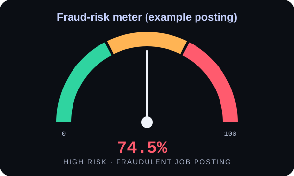
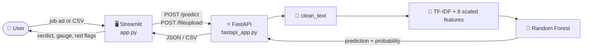
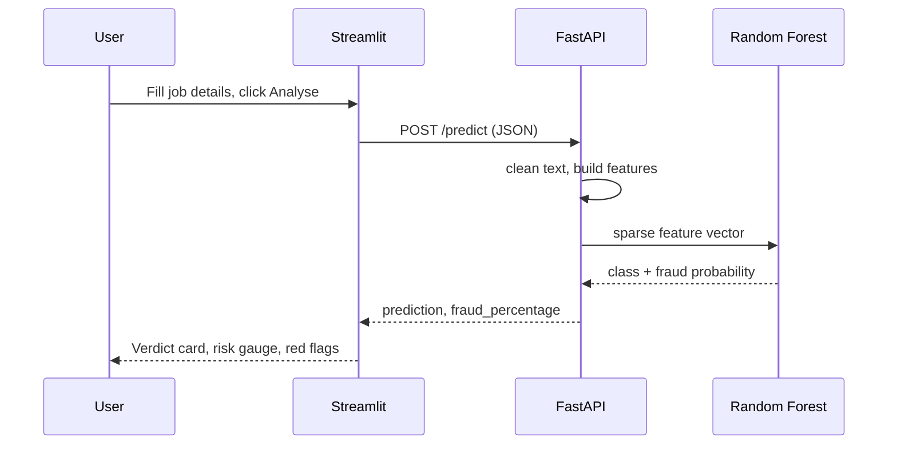
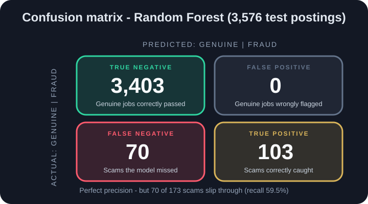

<div align="center">



<br>


[](https://fake-job-posting-detection-system-fastapi.streamlit.app/)
[](https://fake-job-posting-detection-system.onrender.com/docs)

**A machine-learning web app that flags potentially fraudulent job advertisements _before_ you apply or share personal details. Paste one job ad for an instant fraud-risk score, or upload a CSV to score hundreds of postings at once.**

[Live Demo](https://fake-job-posting-detection-system-fastapi.streamlit.app/) •
[How it works](#-how-it-works) •
[Results](#-model-results) •
[Quick Start](#-quick-start) •
[Bulk CSV](#-bulk-csv-upload) •
[API](#-api-reference) •
[Limitations](#-limitations)

</div>

---

<div align="center">
  <a href="https://fake-job-posting-detection-system-fastapi.streamlit.app/">
    
  </a>
</div>

<br>

> **Backend API (Render):** [fake-job-posting-detection-system.onrender.com](https://fake-job-posting-detection-system.onrender.com) · interactive docs at [`/docs`](https://fake-job-posting-detection-system.onrender.com/docs)
> The free Render server sleeps when idle, so the **first request can take 30-60 seconds** to wake up.

---

## 🎯 Overview

Finding a genuine job online is not easy - scam postings ask for bank details, "registration fees" or personal documents. This project learns from **17,880 real job postings** and gives every new posting a **fraud probability**, together with simple, explainable red flags.

### ✨ Features

| | Feature | Details |
|---|---|---|
| 🔎 | **Single posting check** | Enter a title, description, company profile etc. and get a verdict (*Genuine* / *Fraudulent*), a fraud probability and a risk gauge |
| 📂 | **Bulk CSV upload** | Score many postings at once, filter and sort the results, and download the predictions as a CSV |
| 🚩 | **Red-flag checklist** | Rule-based checks (scam wording, missing company profile, no salary, very short description, external links...) shown next to the ML score |
| ⚡ | **REST API** | FastAPI endpoints `/predict`, `/fileupload`, `/health` with auto-generated docs at `/docs` |
| 🧪 | **Demo samples** | One-click suspicious and genuine example postings in the sidebar |

<div align="center">
  
</div>

---

## 🧠 How it works

<div align="center">
  
</div>

| Step | Details |
|------|---------|
| **Dataset** | EMSCAD fake job postings - **17,880 postings, 866 fraudulent (≈ 4.84 %)** |
| **Cleaning** | Empty text is kept as blank (a missing profile is itself a signal), duplicates checked |
| **Text features** | `title + company_profile + description + requirements + benefits` → cleaned → **TF-IDF** (10,000 features, unigrams + bigrams, English stop-words removed) |
| **Structured features (8)** | `telecommuting`, `has_company_logo`, `has_questions`, `has_salary`, `has_company_profile`, `has_requirements`, `has_benefits`, `text_length` |
| **Imbalance handling** | Stratified 80/20 split + `class_weight="balanced"` |
| **Models compared** | Logistic Regression vs Random Forest (200 trees) - the best **fraud-class F1** wins |

### 🏗️ Architecture

The model lives in the **FastAPI backend**. The **Streamlit frontend** only collects the input and shows the answer.





### 🔍 What the data says

Real fraud rates from the dataset - postings that **hide** basic trust signals are far more likely to be fake:

<div align="center">
  
</div>

---

## 📊 Model Results

Evaluated on a **20 % hold-out test set (3,576 postings, 173 fraudulent)**.

<div align="center">
  
</div>

| Model | Accuracy | Precision (Fraud) | Recall (Fraud) | F1 (Fraud) | ROC-AUC |
|-------|---------:|------------------:|---------------:|-----------:|--------:|
| Logistic Regression | 0.9583 | 0.5426 | **0.8844** | 0.6725 | 0.9897 |
| **Random Forest** 🏆 (deployed) | **0.9804** | **1.0000** | 0.5954 | **0.7464** | **0.9904** |

> Accuracy alone is misleading here - predicting "genuine" for everything already gives ~95 %. **Precision, recall and F1 on the fraud class** are the metrics that matter.

<div align="center">
  
</div>

### 📈 Graphs from the notebook

| Class distribution | ROC curve |
|:--:|:--:|
|  |  |
| **Confusion matrix** | **Top fraud features** |
|  |  |

<details>
<summary><b>🖼️ More plots</b></summary>

| Fraud rate - binary features | Fraud rate by employment type |
|:--:|:--:|
|  |  |
| **Top countries (fraud postings)** | **Text length comparison** |
|  |  |

</details>

---

## 🚀 Quick Start

### 1. Install dependencies

```bash
python -m venv venv
source venv/bin/activate        # Windows: venv\Scripts\activate
pip install -r requirements.txt
```

### 2. Start the backend (terminal 1)

Run this from the project folder, because the models are loaded using relative paths.

```bash
uvicorn fastapi_app:app --reload
```

The API runs at `http://127.0.0.1:8000` (interactive docs at `http://127.0.0.1:8000/docs`).

### 3. Start the frontend (terminal 2)

```bash
streamlit run app.py
```

Open the URL Streamlit prints (usually `http://localhost:8501`). The sidebar shows whether the API is online. To use your local backend instead of the Render one, change the **FastAPI URL** field in the sidebar to `http://127.0.0.1:8000`.

---

## 📂 Bulk CSV upload

Scroll to **Upload a CSV of job postings** in the app, choose a `.csv` file and click **Analyse file**. Your CSV must contain these columns (extra columns are kept in the output):

| Column | Type | Notes |
|--------|------|-------|
| `title` | text | |
| `company_profile` | text | can be empty |
| `description` | text | |
| `requirements` | text | can be empty |
| `benefits` | text | can be empty |
| `salary_range` | text | can be empty |
| `telecommuting` | 0 / 1 | remote job |
| `has_company_logo` | 0 / 1 | |
| `has_questions` | 0 / 1 | screening questions |

Click **Download sample CSV template** in the app for a ready-made example. The result adds three columns: `prediction`, `fraud_probability` and `fraud_percentage`.

> The original dataset (`data/fake_job_postings.csv`) already has all required columns, so you can upload it directly. Postings are scored one row at a time, so very large files take a while - try a few hundred rows first.

---

## 🔌 API Reference

| Method | Endpoint | Description |
|---|---|---|
| `GET` | `/health` | Check that the API and model are loaded |
| `POST` | `/predict` | Score one job posting (JSON) |
| `POST` | `/fileupload` | Score a whole CSV and get it back with prediction columns |

### `POST /predict`

```bash
curl -X POST https://fake-job-posting-detection-system.onrender.com/predict \
  -H "Content-Type: application/json" \
  -d '{
        "title": "Work From Home Data Entry - Earn $5000 Weekly",
        "description": "No experience needed! Send your bank details and a registration fee to get started.",
        "telecommuting": 1,
        "has_company_logo": 0,
        "has_questions": 0
      }'
```

```json
{
  "prediction": "Fraudulent Job Posting",
  "fraud_probability": 0.745,
  "fraud_percentage": 74.5,
  "status": "success"
}
```

`title` (min 3 characters) and `description` (min 10 characters) are required; every other field is optional.

### `POST /fileupload`

Accepts a CSV (`multipart/form-data`, field name `file`) and returns a CSV with the prediction columns added.

```bash
curl -X POST http://127.0.0.1:8000/fileupload \
  -F "file=@job_postings.csv" \
  -o job_predictions.csv
```

Returns `400` if the file is not a `.csv` or required columns are missing.

### `GET /health`

```json
{ "status": "API is running", "model_loaded": true, "vectorizer_loaded": true }
```

---

## 📁 Project Structure

```
Fake Job Posting Detection System/
├── app.py                 # Streamlit frontend (single check + bulk CSV upload)
├── fastapi_app.py         # FastAPI backend (/predict, /fileupload, /health)
├── simple-streamlit.py    # Minimal Streamlit client (learning example)
├── requirements.txt
├── data/
│   └── fake_job_postings.csv
├── models/
│   ├── fake_job_model.pkl     # trained Random Forest
│   ├── tfidf_vectorizer.pkl
│   ├── scaler.pkl
│   └── num_cols.pkl           # numeric feature order used in training
├── notebook/
│   └── Fake Job Posting Detection System.ipynb   # EDA, training, evaluation
├── Graphs Used/           # plots exported from the notebook
└── assets/                # animated SVGs used in this README
```

---

## 🛠️ Tech Stack

<div align="center">


</div>

---

## ⚠️ Limitations

- The deployed Random Forest has **perfect precision but only ~60 % recall** on fraud - it rarely raises a false alarm, but it misses some scams (70 of 173 in the test set). A "genuine" result is **not** a guarantee that a job is real.
- The model is trained on one public dataset (EMSCAD) and may not capture newer scam patterns.
- The red-flag checklist is rule-based and independent from the ML score.

**Always verify the employer independently** (official website, LinkedIn, reviews) and never pay money to get a job.

## 🗺️ Possible Improvements

- [ ] Lower the decision threshold or tune `class_weight` to improve fraud recall
- [ ] Add model explainability (top contributing words per prediction)
- [ ] Vectorise bulk scoring so large CSVs run faster
- [ ] Try gradient boosting (XGBoost / LightGBM) and transformer text embeddings
- [ ] Dockerize the API and the Streamlit app

---

## 👤 Author

**Rohit Jha** · [GitHub](https://github.com/Rohit-coder-py) · [LinkedIn](https://linkedin.com/in/rohit-jha-ai)

<div align="center">
  <br>
  
  <br>
  <sub>If you find this project useful, give it a ⭐</sub>
</div>
